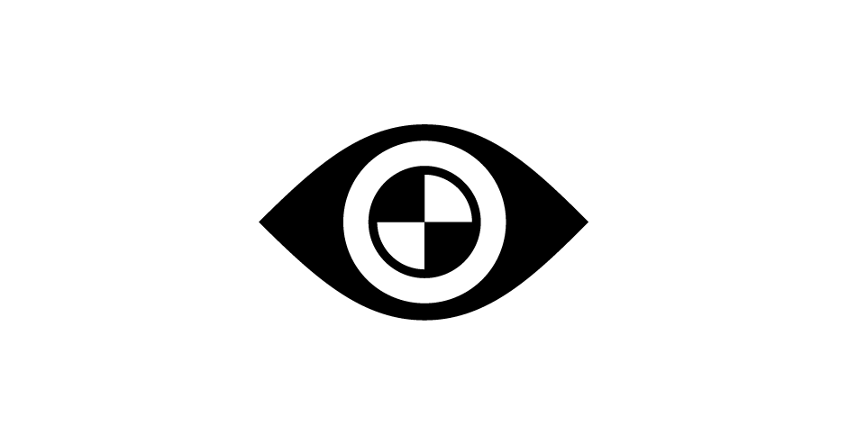
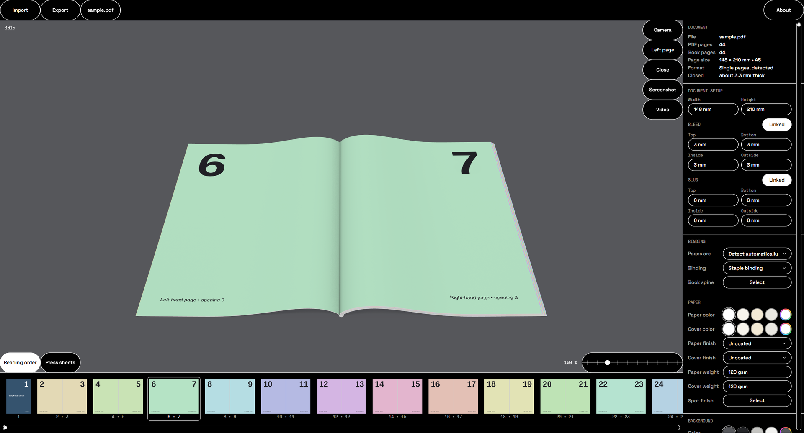

## This software is entirely vibe-coded.

This software was built using Claude Code. I wrote no line of code myself. I did however design the software's visual identity, and UI, I architected standard workflows from my experience as a print designer and thoroughly tested its functions against my own publications.

## What is Printwarden?

Printwarden lets you look at your InDesign PDF as an actual 3D book before it goes to print. You pick the binding and the paper, flip through it and see if the pages end up where you expect them. When you're happy with it, you can export an imposed PDF for your printer, or render screenshots and videos of the book.

It also works the other way around. If you already have imposed sheets, made with Printwarden or with InDesign's Print Booklet, you can import them and Printwarden folds them back into a book so you can check the imposition.

## Folder structure

There's no installer. Printwarden keeps its settings, cache and logs in a folder called `Printwarden Data`, which sits next to `Printwarden.exe` on Windows and inside `Printwarden.app` on macOS. If something goes wrong, delete that folder and the app starts fresh.

## Usage

Download the zip for your system from the Releases page, unzip it into its own folder and run `Printwarden.exe` or `Printwarden.app`. The Mac version runs on both Apple Silicon and Intel.

I don't sign the builds, so Windows and macOS will complain the first time you open the app:

- **Windows**: click "More info", then "Run anyway".
- **macOS**: open the app once and close the warning. macOS will not allow you to open it right away, you need to allow it in System Settings > Privacy & Security.

If you'd rather not do that, you can run it from the source instead.

## Running from the source

1. Install Node.js (the LTS version) from <https://nodejs.org>.
2. Download or clone this repository.
3. On Windows, double-click `_build/Start (Windows).bat`. On a Mac, double-click `_build/Start (macOS).command`. If macOS won't run it, run `chmod +x` on the file once in Terminal.

The first start downloads Electron, which is a few hundred MB. If you want to build the app yourself, have a look at [`_build/README.txt`](_build/README.txt).

## Features

- **Import**: Printwarden automatically detects whether your imported PDF is set up as spreads or single sheets. Imposed sheets work too. Page size, bleed and slug are read from the PDF, but you can also type them in. If you change the page size, the page dimensions are automatically adjusted without touching the content, letting you get a feel for different publication dimensions.
- **Bindings**: staple, perfect, sewn, hardcover, spiral and wire-o. The spine width is calculated from the PDF. You can also manually enter a spine width, as well as assign it a color or design.
- **Paper**: color, finish and weight, set separately for the pages and the cover. The 3D simulation accounts for cover and paper weight: the pages respond correctly by arching more if the paper weighs more and vice versa.
- **Spot finish**: gold, silver or copper foil and spot UV, taken from a separate PDF of the finish.
- **3D view**: click and drag to turn the view. It will snap back to the default view. If you hold space and pan around, the view will be "unlocked". You can double tap your space bar to reset the view. There are a variety of different camera presets to test out, you can also center the view on either side of the spread.
- **Timeline**: your imported PDF in chronological order or in imposed order.
- **Preflight**: any uncertainties automatically caught by the software will be displayed here.
- **Imposed PDF export**: you can export an imposed PDF with creep compensation.
- **Screenshots and videos**: you can render screenshots or a flipbook animation.
- **Color**: CMYK is rendered with the PDF's output intent if it has one, otherwise with a CMYK profile from your computer.
- **Your files are safe**: Printwarden only reads the PDF you open and only writes the files you save yourself. It won't overwrite the PDF you imported, it doesn't go online and it doesn't ask for any permissions.

## Controls

- **Drag**: turn the book (it springs back when you let go)
- **Space + drag**: move the view
- **Press space twice**: reset the view
- **Mouse wheel**: zoom
- **Click a page**: turn the page

## Color profiles

Printwarden doesn't come with a CMYK profile of its own. It uses the ones already on your computer, from the system's color folders and Adobe's. By default it picks the closest match to coated offset printing, which is usually ISO Coated v2 or Coated FOGRA39 (InDesign installs those). If it can't find any, it falls back to the profile built into pdf.js. Your profiles are only read and never changed.

## Credits

All the projects Printwarden uses code from are listed in [`CREDITS.md`](CREDITS.md). You can also find their licenses in the app under About > Licenses.

## License

Printwarden is licensed under the Apache License 2.0 (see `LICENSE` and `NOTICE`). The third-party code it includes keeps its own licenses, which are listed in `CREDITS.md`.

The release builds include FFmpeg 9.0.2 for ProRes video. It's compiled from the official source with only the parts Printwarden needs and nothing under the GPL, so it's licensed under the LGPL 2.1 or later. Printwarden runs it as a separate program and doesn't modify it. Its license and build notes sit next to it, and the FFmpeg source is attached to each release. FFmpeg is a trademark of Fabrice Bellard. Printwarden is not affiliated with the FFmpeg project.
